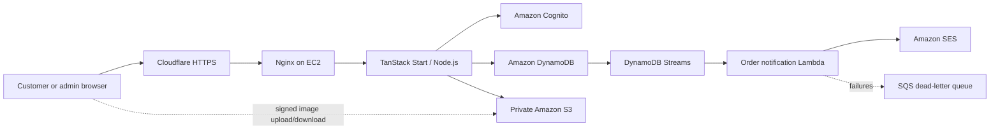

# IntelliMart — Team & Viva Guide

**Team:** Nikhil, Shreya, Khushboo  
**Goal:** Explain what the project does, how one request moves through the code, and how S3 and DynamoDB are used.

## 1. Project overview (short presentation)

IntelliMart is a full-stack online storefront built with React, TypeScript and TanStack Start. Customers browse products, keep a cart and wishlist, register and sign in, place orders, and write reviews for eligible purchases. Admins manage products, images, prices and order statuses.

The storefront runs as a Node.js server on EC2. It uses Cognito for customer identity, DynamoDB for application records, a private S3 bucket for images/files, and SES for order email. Card and UPI choices are **mocked**: they collect no payment details and charge no money. Cash on delivery is also available.

### Architecture at a glance



The browser calls same-origin TanStack **server functions**; there is no separate Express REST API. Cloudflare/Nginx provides HTTPS and forwards requests to the Node process bound to `127.0.0.1:3000`. The independent email worker still uses Lambda; the storefront itself is hosted on EC2. CDK also contains the former Lambda/API storefront deployment branch until the legacy resources are removed after EC2 verification.

## 2. Where to look in the repository

| Code | Responsibility |
| --- | --- |
| `src/routes/` | Page-level routes: shop, product, checkout, account and admin |
| `src/components/` | Reusable visual components and forms |
| `src/functions/*.functions.ts` | Typed server-function endpoints and input validation |
| `src/server/*.server.ts` | Server-only AWS SDK calls and business rules |
| `src/domain/contracts.ts` | Zod request schemas and shared validation contracts |
| `src/domain/cartTotals.ts` | Authoritative cart/order total calculations |
| `src/services/` | Browser-side adapters that call server functions |
| `src/hooks/` | React state/context for auth, cart and wishlist |
| `backend/infra/app.ts` | CDK definitions for DynamoDB, Cognito, S3, SES and the email worker |
| `backend/src/notifications.ts` | DynamoDB Stream consumer that sends order email through SES |
| `docs/ec2-deployment.md` | EC2, Nginx, Cloudflare DNS and TLS deployment runbook |

**Typical request path:** a route calls a service → the service calls a `createServerFn` endpoint → middleware validates the session/input → a server module applies business rules and calls AWS SDK v3 → the result returns to the browser.

## 3. Concepts everyone should know

- **SSR (server-side rendering):** Node can produce the initial HTML response, while React hydrates it in the browser.
- **Server function:** a typed TanStack Start RPC boundary. It runs on the server even when imported by UI code; it is not a browser-side AWS SDK call.
- **Zod validation:** contracts in `src/domain/contracts.ts` reject malformed or out-of-range inputs before business logic runs.
- **AWS SDK v3:** service clients (`DynamoDBDocumentClient`, `S3Client`, Cognito client) run in `src/server/`. On EC2 they should obtain short-lived credentials from the instance role—not hard-coded access keys.
- **Authorization:** authentication asks “who signed in?”; authorization asks “may this user do this?” Customer data is keyed by Cognito `sub`. Admin operations check live membership in the Cognito `Admins` group on the server.
- **Transactional inventory:** order creation updates stock, removes cart lines and writes the order/idempotency record atomically. Either the full transaction succeeds or none of it does.
- **Mock payment:** card/UPI approval only records `payment.status = "mocked"`; it does not call a payment company, verify funds, or settle money. COD remains `pending` until collection.
- **Private by default:** S3 blocks public access. The app issues short-lived signed URLs/forms for specific objects instead of exposing AWS keys or opening the bucket.

### Authentication path

1. `src/functions/auth.functions.ts` validates sign-in/sign-up requests and calls `src/server/auth.server.ts`.
2. Cognito verifies credentials and email. The app creates an opaque, HttpOnly, SameSite cookie.
3. `src/server/session.server.ts` stores a hash of the cookie identifier as the DynamoDB key; Cognito access/refresh tokens remain server-side.
4. Customer server functions require the session. Admin functions additionally call `requireAdmin()` and verify current `Admins` group membership.

## 4. Shreya — teach the S3 integration

### What S3 stores

The media bucket is private. It contains imported catalogue images under `catalogue/`, admin product uploads under `products/admin/<cognito-sub>/`, and customer uploads under `customers/<cognito-sub>/`. The EC2 role needs `s3:GetObject` on `catalogue/*` for the imported images that appear in the storefront; it also needs the appropriate product/customer prefix access for current reads and uploads.

### Admin product image upload: code path

1. The admin page calls `adminService.uploadImage(file)` in `src/services/admin/index.ts`.
2. The browser asks `adminUploadFn` for a short-lived upload policy.
3. `src/server/admin.server.ts::uploadImage` checks the admin session, creates a random object key, writes a one-hour upload receipt in DynamoDB, and creates a five-minute S3 presigned POST restricted to the expected key, MIME type and size.
4. The browser sends the file directly to the S3 presigned URL. It never receives AWS credentials.
5. On product creation, the server checks that the key belongs to that admin, the receipt is valid, and S3 `HeadObject` reports the expected content type and byte length. The product record stores an `s3://bucket/key` reference.
6. When a product is returned to a browser, `src/server/aws.server.ts::imageUrl` turns the S3 reference into a short-lived signed `GetObject` URL.

Simplified browser upload pattern from `src/services/admin/index.ts`:

```ts
const policy = await adminUploadFn({ data: { contentType: file.type, size: file.size } })
const form = new FormData()
for (const [name, value] of Object.entries(policy.fields)) form.append(name, value)
form.append("file", file) // S3 POST requires file last
await fetch(policy.url, { method: "POST", body: form, credentials: "omit" })
```

Simplified signed image read from `src/server/aws.server.ts`:

```ts
getSignedUrl(s3, new GetObjectCommand({ Bucket: bucket, Key: objectKey }), {
  expiresIn: 900,
})
```

### Shreya’s viva questions

**Why use S3 instead of saving image bytes in DynamoDB?** S3 is object storage designed for files; DynamoDB stores compact structured records and references.

**Why is the bucket private if users can see images?** The server signs a narrowly scoped, expiring GET URL. The object stays private; the URL grants temporary access to that object.

**What is a presigned POST?** A short-lived, signed form policy that allows a browser to upload a specific object under constrained conditions without AWS credentials.

**What does CORS do here?** It lets the browser make the signed cross-origin S3 request from the allowed storefront origin. CORS is not authorization and does not make the bucket public.

**Why does the EC2 role need `catalogue/*`?** The imported product records point at keys such as `catalogue/photo-….jpg`; the server must sign `GetObject` requests for those keys. `products/*` alone does not cover them.

## 5. Khushboo — teach the DynamoDB integration

### Single-table design

The table uses string partition/sort keys named lowercase `pk` and `sk`. Prefixes identify record types, so related access patterns can use `Query` on one partition:

| Record | Example key | Purpose |
| --- | --- | --- |
| Product | `pk=CATALOG`, `sk=PRODUCT#<id>` | Catalogue item; domain object stored in `data` |
| Category | `pk=CATALOG`, `sk=CATEGORY#<id>` | Category and product count |
| Customer cart line | `pk=USER#<cognito-sub>`, `sk=CART#<product-id>` | Quantity, saved-for-later flag and revision |
| Wishlist item | `pk=USER#<cognito-sub>`, `sk=WISH#<product-id>` | Customer-owned saved item |
| Customer order | `pk=USER#<cognito-sub>`, `sk=ORDER#<order-id>` | Snapshot of items, address, total and payment/order status |
| Idempotency record | `pk=USER#<cognito-sub>`, `sk=REQUEST#<uuid>` | Prevents a retry from creating a second order |
| Session | `pk=SESSION#<sha256-cookie-id>`, `sk=SESSION` | Server-side session and Cognito tokens |

Admin order listing uses the `OrdersByEntity` GSI: `entity` is the partition key (`order`) and `sk` sorts order records. It queries the index, then performs a strongly consistent read of each base-table order to avoid showing stale status after an update.

### Code path and reliability

- `src/server/aws.server.ts` creates the document client and common `Get`/`Query` helpers.
- `src/server/customer.server.ts` owns customer cart, wishlist, order and file operations.
- `src/server/admin-orders.server.ts` lists orders and makes conditional status/inventory changes.
- `src/functions/customer.functions.ts` and `admin.functions.ts` validate inputs and enforce session/admin middleware before calling those modules.

Order creation recalculates totals on the server; the client’s expected total is only a stale-price check, not trusted pricing. A DynamoDB transaction then checks/decrements stock, deletes the exact cart revisions, and writes the order plus idempotency record. On cancellation, another transaction changes status and restores stock once. DynamoDB conditional expressions protect against stale edits and simultaneous requests.

Simplified query pattern from `src/server/aws.server.ts`:

```ts
new QueryCommand({
  TableName: table,
  KeyConditionExpression: "pk = :pk AND begins_with(sk, :prefix)",
  ExpressionAttributeValues: { ":pk": pk, ":prefix": prefix },
  ConsistentRead: true,
})
```

The table is on-demand and uses AWS-managed encryption, point-in-time recovery, TTL on `expiresAt`, and a `NEW_IMAGE` stream. The stream drives the separate order-email worker; failures go to an SQS dead-letter queue. TTL is cleanup, not a substitute for order/cancellation business logic.

### Khushboo’s viva questions

**Why NoSQL for this project?** The app needs flexible item shapes and predictable key-based reads/writes for a small storefront; DynamoDB provides managed, low-latency key-value/document access.

**What are `pk` and `sk`?** The partition key groups records; the sort key orders/distinguishes records in that group. Together they uniquely identify a table item.

**What is a GSI?** A Global Secondary Index provides another query key pattern. `OrdersByEntity` lets admins find orders across customer partitions without scanning the whole table.

**Why transact a checkout?** Stock decrement, cart removal and order creation must succeed together. A transaction prevents partial checkout state.

**What is idempotency?** Repeating the same checkout request key returns the original order instead of creating a duplicate.

## 6. Team viva quick questions

**Where does business logic live?** In server-only modules under `src/server/`; UI components call typed endpoints under `src/functions/`.

**Why not call DynamoDB from React?** Browser code must not contain AWS credentials or unrestricted database access. The server validates identity and applies authorization/business rules.

**What is an EC2 instance role?** An IAM role attached through an instance profile. The AWS SDK obtains temporary credentials automatically; no long-lived keys are stored on the machine.

**What does the mock payment mean?** It is an educational UI simulation only. No gateway, card data, authorization, or real charge is involved.

**How are order emails sent?** A DynamoDB Streams event invokes the notification Lambda, which sends through SES; the SQS DLQ holds failed event batches for investigation/retry.

**What should we say about deployment status?** The storefront bundle targets Node.js on EC2. The intended request path uses Cloudflare, Nginx and EC2; the DynamoDB/Cognito/S3/SES services remain managed AWS services. Do not claim the legacy storefront Lambda/API has been deleted until the reviewed `resourcesOnly=true` CDK deployment has actually completed.

## 7. 30-second closing summary

“IntelliMart is a TypeScript e-commerce application. The browser talks to same-origin TanStack server functions, which validate input and session/admin permissions before server-only AWS SDK calls. DynamoDB stores catalogue and customer/order records using `pk`/`sk`; transactions protect inventory and checkout consistency. S3 stores private images and uses short-lived signed uploads/downloads. Cognito handles identity, SES sends order email through a stream worker, and card/UPI is only a clearly labeled mock with no charge.”
